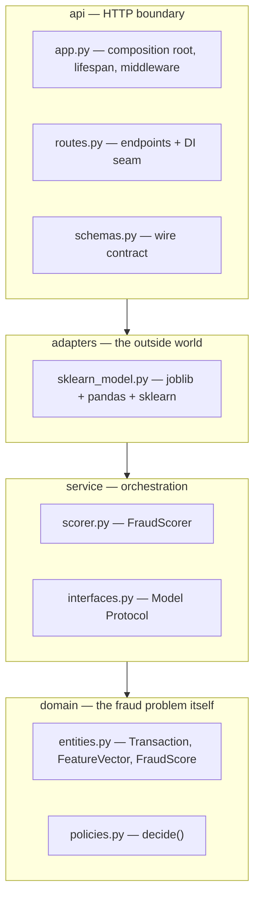
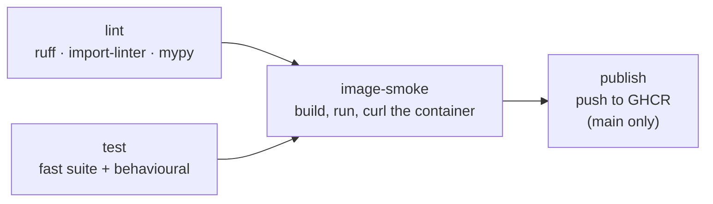

# Fraud Scoring Service

[](https://github.com/8alubaid/SDA-AIE-113/actions/workflows/ci.yml)
[](https://www.python.org/)

A production-grade REST service that scores card transactions for fraud risk and
returns an **allow / review / block** decision.

The project's real subject is the *journey*, not the model. It starts as a single
exploratory Jupyter notebook (`notebook_v1.ipynb`) and is refactored, lab by lab,
into a layered, tested, containerised, CI-gated service. The pre-trained model
artefact never changes — so every improvement is an *engineering* improvement,
and the gap between "it runs on my machine" and "it runs in production" is
visible in isolation.

> **Training program:** completed under **SDA-AIE-113 — Software Engineering
> Practices for AI Systems**, delivered by SDAIA Academy.
> See [Training program attribution](#training-program-attribution).

---

## Table of contents

- [What the service does](#what-the-service-does)
- [Architecture overview](#architecture-overview)
- [Engineering decisions](#engineering-decisions)
- [Repository structure](#repository-structure)
- [Prerequisites](#prerequisites)
- [Installation and setup](#installation-and-setup)
- [Configuration and environment variables](#configuration-and-environment-variables)
- [Running the service](#running-the-service)
- [API reference](#api-reference)
- [Expected output](#expected-output)
- [Testing and quality gates](#testing-and-quality-gates)
- [Performance](#performance)
- [CI/CD pipeline](#cicd-pipeline)
- [Observability](#observability)
- [Security and secrets](#security-and-secrets)
- [Git and version-control practices](#git-and-version-control-practices)
- [Known issues](#known-issues)
- [Training program attribution](#training-program-attribution)

---

## What the service does

A client POSTs one transaction. The service derives features from it, runs the
bundled scikit-learn pipeline, applies the risk-approved decision policy, and
returns a probability plus a decision — with a correlation ID for tracing.

**Decision bands** (with the default block threshold of `0.85` and a fixed
review band of `0.15`):

| Fraud probability  | Decision | Meaning                        |
| ------------------ | -------- | ------------------------------ |
| `p >= 0.85`        | `block`  | Reject the transaction         |
| `0.70 <= p < 0.85` | `review` | Route to a human fraud analyst |
| `p < 0.70`         | `allow`  | Approve                        |

Both bounds move together with `FRAUD_BLOCK_THRESHOLD`, so the policy is
configuration, not code.

**Features** are derived in exactly one place (`Transaction.to_features()`), so
batch scoring and online serving cannot drift apart:

| Feature       | Derivation                                             |
| ------------- | ------------------------------------------------------ |
| `amount_log`  | `log1p(amount_sar)`                                    |
| `channel`     | one of `pos`, `ecom`, `atm`, `transfer`                |
| `mcc`         | merchant category, trimmed, upper-cased, spaces to `_` |
| `hour_of_day` | hour from the transaction timestamp                    |
| `is_night`    | `1` when hour < 6, else `0`                            |

**Model artefact:** `models/fraud_xgb_v3.joblib` — a joblib bundle of
`{"pipeline": ..., "version": "v3.2.0"}`. It is loaded **once**, at application
startup: never at import time, never per request.

---

## Architecture overview

The codebase follows a clean-architecture layering. The rule is one-directional:
**a layer may only import from layers below it.** This is not a convention kept
by code review — it is a machine-checked contract (`import-linter`) that fails CI
when violated.



**Why each boundary exists:**

- **`domain/`** imports only the standard library and pydantic — no pandas, no
  sklearn, no joblib. It is the vocabulary of the problem, and it tests in
  milliseconds.
- **`service/`** depends on a `Model` **Protocol**, not on scikit-learn. That
  single seam is what lets the API test suite inject a constant fake model and
  assert the HTTP contract without ever loading the real artefact.
- **`adapters/`** is the only place that knows the model is a joblib-pickled
  scikit-learn pipeline fed by a pandas DataFrame. Swapping to ONNX or a remote
  inference server touches this directory alone.
- **`api/`** keeps the wire contract (`schemas.py`) deliberately separate from
  the domain entity. The public API shape can version independently of what "a
  transaction" means internally.
- **Composition roots.** Dependencies are wired in exactly two places —
  `api/app.py` for the HTTP entrypoint, `batch.py` for offline scoring. Every
  other module is handed what it needs.

**Two deliberate serving decisions:**

1. The `/v1/predict` handler is a plain `def`, not `async def`. scikit-learn
   inference is blocking CPU work; FastAPI runs sync handlers in a threadpool,
   whereas `async def` would run that work directly on the event loop. See
   [Performance](#performance) for what happened when this was measured rather
   than assumed.
2. The model is warmed up during `lifespan` startup, so the first real user
   request does not pay the lazy-initialisation cost — worth about 46 ms.

---

## Engineering decisions

[`DECISIONS.md`](DECISIONS.md) is the decision record: eleven trade-offs made
while refactoring the notebook into this service, each stating the options
considered, what was chosen, the concrete reason, and what the choice costs.

Among them: why the route handler is a plain `def` when the benchmark did not
support it, why the model loads in `lifespan` rather than at import time, why the
validation error envelope is rebuilt instead of passed through, why the container
healthcheck targets `/v1/ready` rather than `/v1/health`, and why two lint rules
are suppressed narrowly instead of being obeyed or disabled globally.

---

## Repository structure

```
.
├── src/fraud_service/
│   ├── domain/
│   │   ├── entities.py          # Transaction, FeatureVector, FraudScore, Channel, Decision
│   │   └── policies.py          # decide() — the allow/review/block bands
│   ├── service/
│   │   ├── interfaces.py        # Model Protocol — the testability seam
│   │   └── scorer.py            # FraudScorer — features -> model -> policy
│   ├── adapters/
│   │   └── sklearn_model.py     # joblib/sklearn/pandas live here and nowhere else
│   ├── api/
│   │   ├── app.py               # app factory, lifespan, trace/timing middleware
│   │   ├── routes.py            # /v1/predict, /v1/health, /v1/ready
│   │   └── schemas.py           # request/response wire contract + validation
│   ├── config.py                # typed, validated Settings (the ONLY env reader)
│   ├── logging_setup.py         # structured JSON logging + secret masking
│   └── batch.py                 # offline batch-scoring entrypoint
├── tests/
│   ├── conftest.py              # shared fixtures: fake model, client factory
│   ├── unit/                    # fast, no I/O
│   ├── integration/             # app-level via TestClient
│   └── behavioural/             # exercises the real model artefact
├── payloads/
│   ├── sample.json              # one valid request
│   ├── valid/                   # 20 valid requests
│   └── malformed/               # 43 hostile payloads the API must reject
├── data/
│   ├── transactions_sample.csv  # 5,000 synthetic transactions (with training label)
│   ├── golden_scores_v3.csv     # this model's scores — the skew tripwire
│   └── holdout_eval.csv         # held-out evaluation set
├── models/fraud_xgb_v3.joblib   # pre-trained pipeline bundle (v3.2.0)
├── .github/workflows/ci.yml     # lint -> test -> image-smoke -> publish
├── Dockerfile                   # multi-stage, non-root, healthchecked
├── Dockerfile.naive             # the single-stage anti-pattern, for size comparison
├── docker-compose.yml           # local stack
├── Makefile                     # install / run-batch / lint
├── pyproject.toml               # deps + pytest, coverage, mypy, ruff, import-linter config
├── BENCHMARKS.md                # measured load-test results and experiments
├── DECISIONS.md                 # engineering decision record: options, choice, reason
├── notebook_v1.ipynb            # the original notebook, executed, with outputs captured
└── LAB1..6.md, LAB1..6-SETUP.md # the lab briefs
```

---

## Prerequisites

| Requirement    | Version   | Notes                                             |
| -------------- | --------- | ------------------------------------------------- |
| Python         | **3.12+** | Enforced by `requires-python` in `pyproject.toml` |
| pip            | recent    | Ships with Python                                 |
| Git            | any       | To clone the repository                           |
| Docker         | 24+       | **Optional** — only for the container workflow    |
| Docker Compose | v2        | **Optional** — only for the local stack           |
| `make`         | any       | **Optional** — every target is a one-line command you can run directly |

No GPU is required. The model artefact is committed to the repository, so there
is nothing to download or train.

---

## Installation and setup

```bash
git clone https://github.com/8alubaid/SDA-AIE-113.git
```

```bash
cd SDA-AIE-113
```

Create and activate a virtual environment:

```bash
python -m venv .venv && source .venv/bin/activate
```

On Windows PowerShell, activate with `.venv\Scripts\Activate.ps1` instead.

Install the package in editable mode with the development extras:

```bash
pip install -e ".[dev]"
```

Or, equivalently, via the Makefile:

```bash
make install
```

Verify the install:

```bash
pytest -m "not slow"
```

`pip install -e .` alone installs only the runtime dependencies — enough to serve
the API, but not to run the tests or the linters.

> **Windows note.** The Makefile takes a `PYTHON` override for virtualenv
> layouts where `python` is not on the path:
> `make run-batch PYTHON=.venv/Scripts/python.exe`

---

## Configuration and environment variables

**No API keys or third-party credentials are required to run this project.** It
works out of the box with the committed model artefact and the built-in defaults.

All configuration is read in exactly one place — `src/fraud_service/config.py`.
Reading `os.environ` anywhere else is treated as a defect. Every variable is
prefixed `FRAUD_`, validated at startup, and unknown `FRAUD_*` variables are
rejected outright: a typo is a crash, not a silently ignored setting.

| Variable                | Type   | Default                      | Validation                                 | Purpose |
| ----------------------- | ------ | ---------------------------- | ------------------------------------------ | ------- |
| `FRAUD_MODEL_PATH`      | path   | `models/fraud_xgb_v3.joblib` | **File must exist at startup**             | Location of the joblib model bundle |
| `FRAUD_BLOCK_THRESHOLD` | float  | `0.85`                       | `0.5 <= x <= 0.99`                         | Probability at or above which a transaction is blocked |
| `FRAUD_LOG_LEVEL`       | string | `INFO`                       | one of `DEBUG`, `INFO`, `WARNING`, `ERROR` | Log verbosity |
| `FRAUD_REGISTRY_TOKEN`  | secret | *(unset)*                    | held as a `SecretStr`                      | **Optional.** Only needed if the service is extended to pull models from a private registry at startup |

For local development these may go in a `.env` file in the repository root; real
environments should use real environment variables. **`.env` is git-ignored** and
must never be committed.

```bash
FRAUD_BLOCK_THRESHOLD=0.90 FRAUD_LOG_LEVEL=DEBUG uvicorn fraud_service.api.app:app
```

**Fail-fast behaviour.** Configuration is validated during startup, not on the
first request. Pointing `FRAUD_MODEL_PATH` at a missing file aborts the boot with
`model artefact not found: <path>` — an operator-readable error at deploy time,
rather than a 500 for the first customer.

---

## Running the service

### Option 1 — locally with uvicorn

```bash
uvicorn fraud_service.api.app:app --reload --port 8000
```

The service is then at `http://localhost:8000`, with interactive OpenAPI docs at
`http://localhost:8000/docs`.

### Option 2 — Docker

```bash
docker build -t fraud-service:dev .
```

```bash
docker run --rm -p 8000:8000 fraud-service:dev
```

The image is multi-stage (build tooling never reaches the runtime layer), runs as
a non-root user (`uid 10001`), bakes in the model artefact at
`/models/fraud_xgb_v3.joblib`, and declares a `HEALTHCHECK` against `/v1/ready`.
`Dockerfile.naive` is kept alongside it as the single-stage anti-pattern, for the
image-size comparison done during the labs.

### Option 3 — Docker Compose

```bash
docker compose up --build -d
```

See [Known issues](#known-issues) regarding the Compose healthcheck.

### Offline batch scoring

`src/fraud_service/batch.py` is the non-HTTP entrypoint: it scores every row of
`data/transactions_sample.csv` and writes `scored.csv`. See
[Known issues](#known-issues) before running it.

```bash
make run-batch
```

---

## API reference

All endpoints are served under the `/v1` prefix.

### `POST /v1/predict`

Scores a single transaction.

**Request body** — all fields required; **unknown fields are rejected**
(`extra="forbid"`):

| Field               | Type              | Constraints                                            |
| ------------------- | ----------------- | ------------------------------------------------------ |
| `transaction_id`    | string            | 8–64 characters                                        |
| `amount_sar`        | number            | `> 0` and `<= 1,000,000`; booleans explicitly rejected |
| `channel`           | string            | one of `pos`, `ecom`, `atm`, `transfer`                |
| `merchant_category` | string            | 2–40 characters, not blank                             |
| `customer_id`       | string            | 4–64 characters                                        |
| `timestamp`         | ISO-8601 datetime | e.g. `2026-07-05T22:14:00Z`                            |

**Response `200`:**

| Field               | Type   | Description                                     |
| ------------------- | ------ | ----------------------------------------------- |
| `transaction_id`    | string | Echoed back for correlation                     |
| `fraud_probability` | float  | `0.0`–`1.0`, rounded to 6 decimal places        |
| `decision`          | string | `allow`, `review`, or `block`                   |
| `model_version`     | string | Version of the artefact that produced the score |
| `trace_id`          | string | Correlation ID, also returned as `X-Trace-Id`   |

**Response headers:** every response carries `X-Trace-Id` and
`X-Response-Time-Ms`.

**Errors:** `422` for a payload that fails validation (with a field-level
`detail` array), `503` if the model is not loaded.

### `GET /v1/health`

Liveness — "is the process alive?". Performs **no I/O**, ever. Always `200`
while the process is up.

### `GET /v1/ready`

Readiness — "can I serve correctly *right now*?". Returns `503` until the model
has finished loading, `200` afterwards. This is the endpoint the container
healthcheck and any orchestrator should poll.

The distinction matters: a liveness probe that checked the model would get the
process killed and restarted during a slow model load, in a loop.

---

## Expected output

### Health and readiness

```bash
curl -s localhost:8000/v1/health
```

```json
{"status":"ok"}
```

```bash
curl -s localhost:8000/v1/ready
```

```json
{"status":"ready"}
```

### A scoring request

```bash
curl -s localhost:8000/v1/predict -H "content-type: application/json" -d @payloads/sample.json
```

With `payloads/sample.json` — a 412.50 SAR e-commerce transaction — the response is:

```json
{
  "transaction_id": "TXN-2026-00042",
  "fraud_probability": 0.557066,
  "decision": "allow",
  "model_version": "v3.2.0",
  "trace_id": "e15f13a0081c4c58"
}
```

The probability is deterministic for a given input and model version; the
`trace_id` is newly generated per request.

### A rejected request

```bash
curl -s -o /dev/null -w '%{http_code}\n' localhost:8000/v1/predict -H "content-type: application/json" -d @payloads/malformed/amount_as_bool.json
```

```
422
```

### Startup and request logs

Logs are JSON on stdout, one object per line:

```json
{"block_threshold": 0.85, "model_path": "models/fraud_xgb_v3.joblib", "log_level": "INFO", "event": "effective_config", "level": "info", "timestamp": "2026-09-01T09:54:35.267004Z"}
{"version": "v3.2.0", "seconds": 2.895, "event": "model_loaded", "level": "info", "timestamp": "2026-09-01T09:54:38.162505Z"}
{"decision": "allow", "probability_bucket": 0.6, "model_version": "v3.2.0", "latency_ms": 90.3, "event": "prediction_served", "path": "/v1/predict", "trace_id": "e15f13a0081c4c58", "level": "info", "timestamp": "2026-09-01T09:54:38.270697Z"}
```

### Test suite

```bash
pytest -m "not slow"
```

```
56 passed
Required test coverage of 80.0% reached. Total coverage: 80.44%
```

---

## Testing and quality gates

The suite is split by cost and by what each layer is allowed to touch, using
registered pytest markers (`--strict-markers` rejects typos):

| Marker        | What it covers                                                       |
| ------------- | -------------------------------------------------------------------- |
| `unit`        | Pure domain logic — feature derivation, decision bands. No I/O.       |
| `integration` | The HTTP contract via `TestClient`, with a fake model injected through `dependency_overrides`. Includes the 43-payload malformed corpus. |
| `behavioural` | Properties of the **real** artefact: invariance to merchant-name casing, monotonicity in amount. |
| `slow`        | Excluded from the per-commit gate.                                    |

```bash
pytest
```

```bash
pytest -m unit
```

```bash
pytest -m "not slow"
```

Coverage is measured with branch coverage and **fails under 80%**
(`[tool.coverage.report] fail_under = 80`). The adapter and the batch entrypoint
are excluded from measurement — they are integration surface, covered by the
behavioural and image-smoke tests instead.

Three static gates run alongside the tests:

```bash
ruff check src tests
```

```bash
lint-imports
```

```bash
mypy src/fraud_service --strict
```

Ruff runs with its default rule set plus one documented, narrowly scoped
exemption in `pyproject.toml`:

```toml
[tool.ruff.lint.per-file-ignores]
"src/fraud_service/api/routes.py" = ["B008"]
```

`B008` forbids function calls in argument defaults — but `Depends(...)` in a
parameter default is FastAPI's own dependency-injection idiom, and it is exactly
what makes the `get_scorer` seam overridable in tests. The rule is suppressed for
that one file rather than globally.

There is a second, similarly narrow suppression inline in `schemas.py`: `TRY004`
asks for `TypeError` on a type check, but pydantic only converts `ValueError` and
`AssertionError` into a `ValidationError`. Raising `TypeError` there would turn a
422 into a 500, so the rule is suppressed on that line with the reason recorded
next to it.

---

## Performance

Measured, not estimated — full method and raw numbers in
[`BENCHMARKS.md`](BENCHMARKS.md). Load generated with `hey`, 2000 requests at
concurrency 50, client and server sharing one machine (so throughput is a floor,
not a capacity figure).

| Metric           | Value                                  |
| ---------------- | -------------------------------------- |
| Requests/sec     | **139.4** (median of 5 runs)           |
| p50 latency      | **346 ms**                             |
| p99 latency      | **485 ms**                             |
| Errors           | 0 — all 2000 responses `200`, every run |

**Startup warm-up pays off.** First-request latency on a cold server drops from a
median of 60.4 ms to 14.4 ms with the `lifespan` warm-up enabled — roughly 46 ms,
about 4x, paid once at startup before the service reports ready.

**An honest negative result.** The textbook expectation is that declaring the
route `async def` would serialise blocking CPU work on the event loop and
collapse throughput. Across five interleaved runs of each variant, **that effect
did not appear** at this concurrency on this hardware (`def` median 139.4 rps vs
`async def` 152.9 rps). The handler stays a plain `def` because the reasoning
still holds under load the benchmark did not reach — but the measurement is
reported as it came out, not as it was expected to.

---

## CI/CD pipeline

`.github/workflows/ci.yml` runs on every pull request, on pushes to `main`, and
on manual dispatch. Superseded runs on the same branch are cancelled
automatically, and the default token permission is read-only.



1. **`lint`** — the cheapest gate runs first: seconds, not minutes.
2. **`test`** — the per-commit suite, then the behavioural gate against the real
   artefact.
3. **`image-smoke`** — builds the image once (with GitHub Actions layer caching),
   starts the container, polls `/v1/ready`, then POSTs a real payload and asserts
   the response is a well-formed score. This proves the **artefact** works, not
   just the source tree.
4. **`publish`** — only on pushes to `main`, never on pull requests. Pushes to
   GHCR tagged with both the commit SHA and `main`, using a `packages: write`
   token scoped to that job alone.

---

## Observability

- **Structured JSON logs to stdout.** The platform owns shipping and retention;
  the application just writes one JSON object per line.
- **Correlated.** Middleware generates a 16-character trace ID per request and
  binds it to the logging context, so every line emitted while handling that
  request carries the same `trace_id` — and so does the client's `X-Trace-Id`
  response header.
- **Privacy by construction.** The `prediction_served` event logs the decision, a
  *bucketed* probability, the model version, and the latency. It deliberately
  never logs the customer ID, the amount, or raw feature values.
- **Defensive masking.** A structlog processor replaces the value of any key
  matching a sensitive name (`password`, `token`, `secret`, `authorization`,
  `national_id`, `card_number`) with `***MASKED***`, so an accidentally logged
  secret leaves the process already redacted.
- **Latency percentiles come from the logs themselves.** Every request logs
  `latency_ms`, so `p95` can be computed with `jq` alone — no separate
  load-testing tool involved.

---

## Security and secrets

- **No secrets in the repository.** The only credential the service understands,
  `FRAUD_REGISTRY_TOKEN`, is optional, unset by default, and typed as a pydantic
  `SecretStr` so it does not leak through `repr()` or a config dump.
- **`.gitignore` excludes** `.env`, virtualenvs, build artefacts (`build/`,
  `dist/`, `*.egg-info/`), caches (`__pycache__/`, `.pytest_cache/`,
  `.ruff_cache/`, `.mypy_cache/`), coverage output (`.coverage`, `htmlcov/`), and
  generated data (`scored.csv`).
- **Effective-config logging** prints thresholds and paths at startup — never
  secret values. This is what catches configuration drift during an incident.
- **Input validation is a security control.** `extra="forbid"`, per-field bounds,
  and the explicit boolean rejection on `amount_sar` (booleans are a subclass of
  `int` in Python and would otherwise coerce to `1.0`/`0.0` and pass the range
  checks) are all regression-tested against the 43-payload hostile corpus.
- **The container** runs as a non-root user and ships without a build toolchain.

---

## Git and version-control practices

The history is incremental — the classroom baseline plus one commit per lab, each
a reviewable unit of work rather than a single bulk upload:

```
chore: classroom starting point (Lab 1 baseline)
refactor: extract clean architecture layers from notebook
wip(api): schemas, routes, and app factory for /v1/predict (Part A)
feat(docker): multi-stage image, compose stack, healthchecks
feat(tests): unit/integration/behavioural suite, fix bugs it caught
refactor: extract clean architecture layers from notebook
add: the workflow of CI
feat(api): prediction endpoint with validation, health, tracing
add: created the config for fraud_service and logging setup
fix lint issue
linting fixed
rmed observability: unused
fixed the return validation error for boolean amount
chore(notebook): execute notebook_v1 end to end and capture cell outputs
docs: add DECISIONS.md engineering decision record
docs: professional README with setup, API, architecture, and attribution
```

Conventions followed:

- **Conventional-commit style prefixes** (`feat`, `refactor`, `chore`, `fix`)
  with an optional scope, so the history is scannable and the intent of each
  change is stated up front.
- **Imperative subject lines** describing what changed, not "update files".
- **One concern per commit** — the Docker work, the test suite, the CI workflow,
  and the config/logging hardening each land separately, so any one of them can
  be reviewed or reverted on its own.
- **`.gitignore` from the first commit**, so no secret, virtualenv, cache, or
  generated file has ever entered the history.

---

## Known issues

Documented rather than hidden — open items, each with a known fix:

1. **`make run-batch` crashes.** `batch.py` treats the return value of
   `FraudScorer.score()` as a `Decision` when it is a `FraudScore`, raising
   `AttributeError: 'FraudScore' object has no attribute 'value'`. The fix is to
   read `.decision.value` from the returned score. On the same path,
   `SklearnModel.load` is passed a `str` where it expects a `Path`. The HTTP
   service is unaffected.
2. **`mypy --strict` does not yet pass** over `src/fraud_service` — 16 errors,
   mostly missing annotations on the FastAPI lifespan, middleware, and validator
   callables. `ruff` and `lint-imports` both pass.
3. **The Compose healthcheck URL uses backslashes** (`http:\\localhost:8000/...`),
   so the `fraud-api` service never reports healthy under `docker compose`.
   Building and running the image directly is unaffected.

---

## Training program attribution

This project was completed as the capstone of:

**SDA-AIE-113 — Software Engineering Practices for AI Systems**

delivered by **SDAIA Academy**, the training arm of the Saudi Data and
Artificial Intelligence Authority (SDAIA).

- Project repository:
  [8alubaid/SDA-AIE-113](https://github.com/8alubaid/SDA-AIE-113)

The program covers the engineering practices that turn exploratory machine
learning into a maintainable production system: refactoring notebooks into
layered packages, dependency inversion and testability seams, test strategy for
ML services, containerisation, CI/CD, and hardening configuration, secrets, and
logging.
